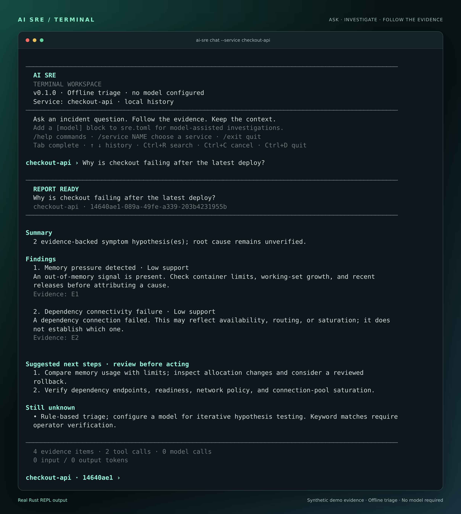

# AI SRE

An incident investigation workspace written in Rust. Ask a production question, collect read-only evidence, and keep the findings, citations, follow-ups, and activity history together.



*Real REPL output using the bundled synthetic evidence. This offline demo shows findings, citations, suggested checks, and what remains unknown—no model key required.*

**Status: early alpha.** The Rust engine, CLI, dashboard, operational workflows, four model protocols, MCP client, and reviewed-action executor are implemented. The native registry contains 59 bounded operations across 27 connector types, alongside Prometheus and Loki. Offline triage and the synthetic incident lab need no account or model key. Full behavioral coverage and production readiness remain incomplete; see the [coverage inventory](docs/coverage.md).

## Open the terminal assistant

```sh
cargo install --path . --locked
ai-sre repl
```

Start the interactive assistant with `ai-sre repl` or `ai-sre cli`. Running `ai-sre` alone also opens it when used in a terminal. The REPL includes editable prompts, Tab command completion, searchable history, service/session context, formatted reports, and cancellable progress. Use `ai-sre repl --service checkout-api` to select a service immediately; type `/help` for commands or `/exit` to quit. The `shell` and `chat` aliases remain available. See [terminal usage](docs/terminal.md) for configuration, keyboard shortcuts, and scripting.

Try the session pictured above from this checkout:

```sh
ai-sre --config examples/demo.toml repl --service checkout-api
# Ask: Why is checkout failing after the latest deploy?
```

## Run it

Install Rust using the official toolchain installer, then run from this checkout:

```sh
cargo build --locked
cargo run --locked -- demo
cargo run --locked -- --config examples/demo.toml serve
```

The server binds to loopback port 8080. The dashboard shows the demo investigation and lets you create investigations, inspect evidence, ask follow-ups, resolve incidents, and export JSON. Demo evidence is synthetic and explicitly labeled. The binary embeds the dashboard; Node and Python are not runtime dependencies.

For your own environment:

```sh
cargo run --locked -- init
# Edit sre.toml to configure your evidence sources and optional model.
cargo run --locked -- integrations --verify --service checkout-api
cargo run --locked -- ask 'Why is checkout failing?' --service checkout-api
cargo run --locked -- shell --service checkout-api
```

Configuration paths resolve relative to the TOML file. The default database is `.ai-sre/incidents.db`. `init` preserves existing files. With no configured evidence sources, the investigator reports insufficient evidence instead of inventing a diagnosis.

## What works today

| Capability | Behavior |
| --- | --- |
| Headless investigations | Question argument or stdin, structured JSON output, nonzero exit on failed runs |
| Interactive terminal | Default interactive launch, editable prompts, Tab completion, searchable history, sessions/resume, wrapped reports, traces, and Ctrl+C cancellation |
| Model-assisted reasoning | Chat Completions, Responses, Anthropic, and Gemini protocol adapters with bounded tool loops |
| Local evidence | Service-filtered JSON bundles; Markdown runbooks from a configured directory |
| Observability | Read-only PromQL queries and one-hour Loki log queries |
| Alert intake | Alertmanager deduplication; authenticated Slack/Telegram intake with sender allowlists |
| Workspace | Dashboard, search, status filters, cited evidence, timeline, follow-up, export, manual resolution |
| Persistence | SQLite WAL, atomic claims, per-tool checkpoints, cancellation, resumable activity SSE |
| Execution controls | Per-run budgets, bounded retries/repair, duplicate suppression, source circuits, context projection, durable traces |
| Privacy | No telemetry; secret redaction and reversible configured identifier masking |
| Evaluation | Six offline scenarios, HTTP incident laboratory, and verified synthetic recovery |
| Native connectors | Explicit read operations for Kubernetes, source control, observability, incident tools, and more; [exact catalog](docs/integration-catalog.md) |
| MCP | Session-aware Streamable HTTP and local stdio, bounded messages, explicit tool allowlists |
| Workflow releases | Content-addressed publishing, explicit activation, rollback, and authenticated downloads with ETag caching |
| Operations | Service memory, work items, cron/timezones, concrete proposals, approvals, and verified execution |
| Delivery and fleet | Explicit report delivery; local coding-agent process discovery |

The offline engine recognizes explicit memory, dependency-connectivity, throttling, and disk-capacity symptoms. These are low-confidence hypotheses, not verified root causes. Runbooks, operator notes, and action proposals are excluded from symptom matching. A model can correlate additional evidence, but valid citations establish only that a referenced item exists—not that a claim is correct.

## Configure a model

Add a model block to `sre.toml`:

```toml
[model]
url = "http://127.0.0.1:11434/v1/chat/completions"
name = "your-tool-capable-model"
# key_env = "SRE_MODEL_KEY"
```

For other protocols, set `protocol` as described in [operational workflows](docs/operations.md). For a hosted compatible provider, use its HTTPS endpoint and set the named credential in the process environment. Never put credentials in the TOML file. The provider must support function tools and emit the structured JSON report described by the agent prompt. Hosted-provider compatibility has not been certified; the protocol is exercised against a local mock server in tests. No live model credentials are bundled.

Configuring a remote model authorizes sending the incident question, history, and redacted evidence to that provider. Redaction is best effort: inspect source data and your provider’s retention policy before using sensitive production information.

## Resume and automate

```sh
cargo run --locked -- sessions
cargo run --locked -- ask 'Check the dependency hypothesis' --incident INCIDENT_UUID --json
cargo run --locked -- show INCIDENT_UUID
cargo run --locked -- resolve INCIDENT_UUID
printf '%s' 'Why are requests timing out?' | cargo run --locked -- ask - --service checkout-api --json
```

The shell and CLI use the same library as the API. The Rust modules are public for embedding; the API is not yet stable.

## Validate

```sh
cargo fmt --all -- --check
cargo clippy --locked --all-targets -- -D warnings
cargo test --locked
cargo run --locked -- eval
cargo run --locked -- eval --suite harness --repeat 3 --output .ai-sre/harness.json
```

Tests cover incident lifecycle, persistence, authentication, all four model tool round-trips, masking, connector boundaries, MCP, cancellation, schedule deduplication, signed webhooks, action approval races, expired approvals, and synthetic failure/recovery workflows. The evaluation command measures offline symptom detection only; it is not an infrastructure benchmark or proof of production diagnosis quality.

The optional `scripts/browser-smoke.cjs` exercises the dashboard against a running demo server. It requires Playwright and Chromium, creates a synthetic incident, and checks creation, follow-up, evidence links, resolution, search, and mobile layout. Set `SRE_TEST_URL` and `CHROMIUM_EXECUTABLE_PATH` to override the defaults. Run it from the repository root; screenshots go into the ignored `.ai-sre` directory. These browser dependencies are development-only.

The optional `scripts/operations-smoke.cjs` covers work, memory, schedules, and the action interface. A configured `SRE_ACTION_PROPOSAL_ID` additionally exercises explicit review and recovery in the local lab. See [operational workflows](docs/operations.md) for commands and configuration.

See [agent harness and evaluation](docs/harness.md), [API and integrations](docs/api.md), [architecture](docs/architecture.md), [deployment](docs/deployment.md), and [product roadmap](docs/roadmap.md).

The implementation is organized into eight functional layers with separate modules for native connectors. See [repository layout and module inventory](docs/repository-layout.md) and [workflow registry](docs/workflow-registry.md).

Selected shared tool modules have direct Rust adaptations with source-comparison tests. See the [file-level port status](docs/tool-layer-port.md) and [third-party notices](THIRD_PARTY_NOTICES.md).
