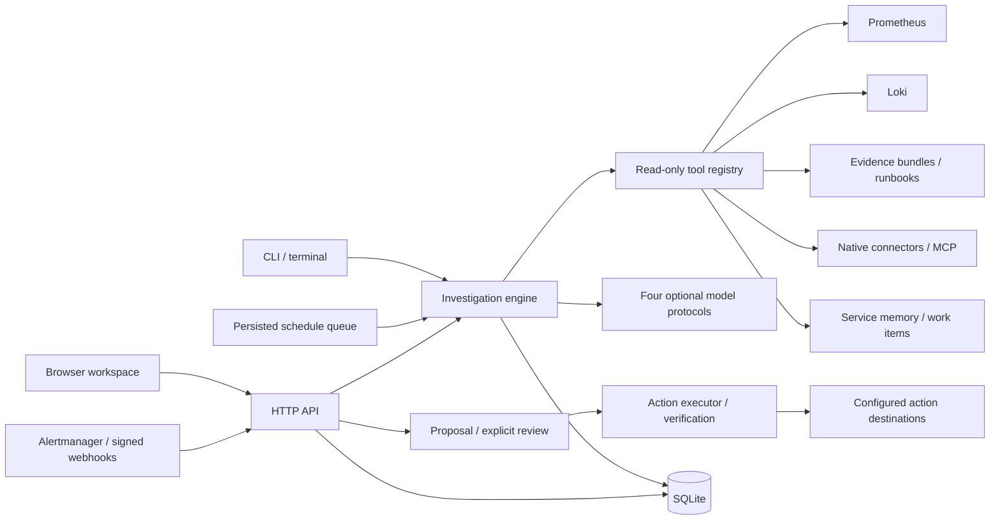

# Architecture

One Rust crate supplies the library, CLI, HTTP service, and embedded dashboard. Tokio drives HTTP I/O; Axum serves requests; reqwest queries fixed upstream endpoints; SQLite keeps incident documents and deduplication keys.

## Investigation lifecycle

`open → investigating → triaged | failed | cancelled → investigating`; an operator can mark a non-running incident `resolved`. Resolved incidents cannot restart. A SQLite immediate transaction serializes claims across processes. The API returns 202 after claiming a run; a background task persists its final outcome independently of the client connection. Poll the incident resource for completion.

Each run collects configured initial context and either applies deterministic symptom rules or enters a model tool loop. Tools receive a service name and validated arguments. The model cannot select arbitrary URLs, read arbitrary local paths, or execute shell commands. The agent checks citations against retained evidence before accepting a structured report. Resumed runs retain prior evidence with collection timestamps and receive the previous report and audit history.

Completed tool results and model usage events are checkpointed during a run. Activity events are available through resumable SSE, and the dashboard polls compact summaries before fetching changed details. Model tokens are not streamed. Run ownership IDs prevent stale workers from overwriting a new run. A process crash can leave a run marked `investigating`. After verifying its worker is stopped, use `recover ID --worker-stopped`, then resume. Graceful server shutdown drains active investigations; forced termination does not.

## Limits

Defaults: 6 model turns, 12 total tool calls per run, 20-second upstream timeout, 4 simultaneous API investigations, 5-minute overall deadline. Configuration ranges are checked at startup. A response is limited to 256 KiB, each evidence payload to 16 KiB, HTTP request bodies to 64 KiB, and local evidence bundles to 256 KiB. Oversized upstream responses fail explicitly; evidence truncation is marked. Each incident allows 128 evidence items and 20 runs. The compatibility list route returns the latest 100 incidents; the compact overview route supports limit/offset pagination. Encoded model requests default to 128 KiB with bounded context projection; the configurable ceiling is 512 KiB. See [harness](harness.md) for token/attempt budgets, source circuits, caching, repair limits, and trace semantics.

Tool errors become explicit evidence gaps. An invalid model report, unknown citation, exceeded budget, or overall timeout produces a durable failed run. An offline run can finish with no findings; its report explicitly states insufficient evidence. No source or model error is interpreted as a healthy service.

## Trust boundaries

The API is single tenant. A shared bearer token grants full incident access. Non-loopback binding requires a token; TLS terminates at an operator-managed reverse proxy. Browser requests are origin checked, the unauthenticated API restricts Host headers to loopback, and the dashboard uses a restrictive content security policy. Static assets and the version-only health endpoint are public. Slack and Telegram webhook routes use their own configured provider authentication and allowlists instead of the workspace bearer token.

Tool URLs come from operator configuration. HTTPS is required except on loopback, redirects are disabled, and platform proxy/CA trust remains active. Credentials are referenced by environment-variable name. Best-effort redaction handles configured credential values, common credential-shaped text, and sensitive JSON keys. It does not anonymize all identifiers, recognize every secret, or encrypt the database. Restrict filesystem access and use encrypted storage when required.

Logs, runbooks, and model responses are untrusted. Prompt instructions and read-only tool restrictions reduce risk, but model-generated text still needs operator judgment. The model can propose a configured action but has no approval/execution tool. A separate operator endpoint executes only reviewed fixed-destination templates, with preconditions and postconditions; see the action trust boundaries in [operations](operations.md).

## Boundaries of this release

No RBAC, SSO, multi-tenant isolation, distributed ownership leases, automatic reconciliation of interrupted mutations, schema migration framework, or retention service. SQLite operations are synchronous; the legacy list API includes full documents, while the dashboard uses compact summaries. Scheduling, per-tool checkpoints, activity SSE, and a separate reviewed-action executor are implemented. This remains a modest local/team workload design; production scale needs measurement and distributed storage/worker engineering.
